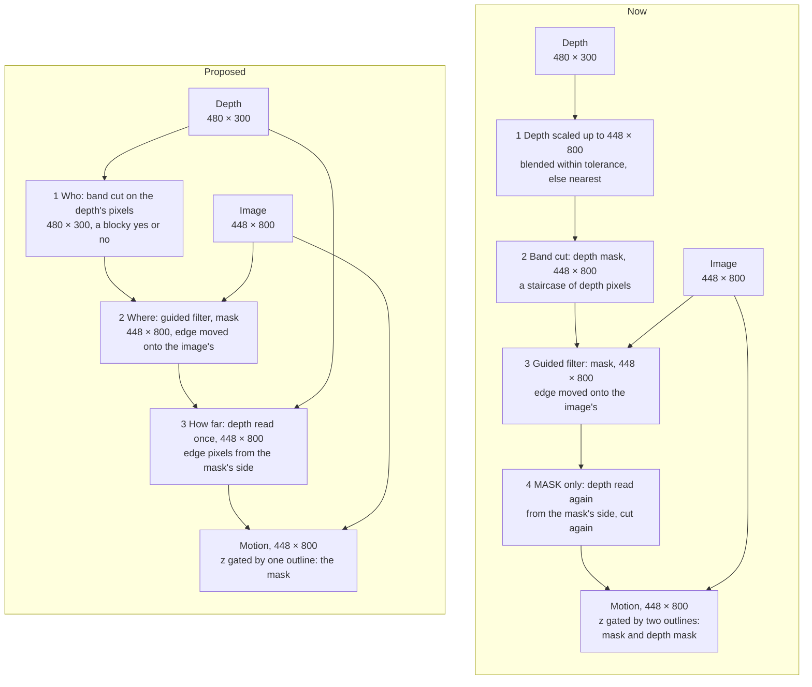

# The flow's plan

What is next for the flow, the one place that says it: the main lines (B to J), along the flow's chain (camera
and view, motion, bridge, the fluid's physics, its look), then those across the stages; each line's items in the
order they are worked (B1, B2, ...); what is parked. A built
item leaves the plan; the others keep their numbers. How each stage works is in its own document
([FLOW.md](FLOW.md) lists them); an item links to the section it changes. **(deduction)** marks what is
inferred, **(site fact)** what the operator saw.

## Main lines

| #   | Line                                                                         | State                            | Documents                                          |
|-----|------------------------------------------------------------------------------|----------------------------------|----------------------------------------------------|
| B   | [The camera and the view](#b-the-camera-and-the-view)                        | built; the depth read to choose  | [VIEW.md](VIEW.md)                                 |
| C   | [The motion](#c-the-motion)                                                  | built; its details open          | [MOTION.md](MOTION.md)                             |
| D   | [The bridge](#d-the-bridge)                                                  | built; the dye's amount to judge | [BRIDGE_3D.md](BRIDGE_3D.md)                       |
| E   | [The 3D fluid's physics](#e-the-3d-fluids-physics)                           | open                             | [FLUID_3D.md](FLUID_3D.md)                         |
| F   | [The 3D fluid's look at 4K](#f-the-3d-fluids-look-at-4k)                     | open                             | [FLUID_3D.md](FLUID_3D.md), [TIMING.md](TIMING.md) |
| G   | [The chain timed as one](#g-the-chain-timed-as-one)                          | built                            | [TIMING.md](TIMING.md)                             |
| H   | [One unit across the stages](#h-one-unit-across-the-stages)                  | not started                      | [FLOW.md](FLOW.md)                                 |
| I   | [The 2D flow follows the 3D](#i-the-2d-flow-follows-the-3d)                  | not started                      | [FLOW.md](FLOW.md)                                 |
| J   | [Every setting and its description](#j-every-setting-and-its-description)    | last, after the refactor         | `CLAUDE.md`, `.claude/rules`                       |

B1, D1 and D2 need the operator at the screen; the other lines go on meanwhile.

The apps on deep_flow's input have their own plan, [apps/APPS_PLAN.md](../../apps/APPS_PLAN.md); recording and
-sim, deep_flow's live checks among them, theirs, [RECORDING_PLAN.md](../recording/RECORDING_PLAN.md).

The 3D fluid's lines are weighed by [its goal](FLUID_3D.md#the-goal): sharp, translucent ink patterns, layers
distinct.

## B. The camera and the view

Built: every capture reaches the motion ([INPUT_THREADS.md](INPUT_THREADS.md)), the mask's edge on the image's
and the depth read across a surface ([VIEW.md](VIEW.md)).

- **B1.** One path for the depth and the mask. The image has 800 rows and the depth 300, and only the image
  knows the player's outline sharply. Now the depth is scaled up first, the masks are cut from that, and `MASK`
  reads it again ([VIEW.md](VIEW.md#the-depth-read)). Instead the depth stays at its own size until the mask
  exists, in three steps, each once, drawn below:
  - Who: the band cut on the depth's own pixels, a blocky yes or no.
  - Where: the guided filter moves that outline onto the image's edges: the mask, the one outline. Where the
    image has no edge it stays the depth's, smoothed.
  - How far: the depth read into the view once, blended within a surface, at the outline from the mask's side.
    The depth mask is that depth's cut and lies on the mask's outline.
  - `depth_read` and its `SURFACE` go; `tolerance` keeps one job, the blend within a surface.
  - Measured against the path now, on stillslowfast, the motion's thresholds at 0: the one results table
    (noise, slow, fast, fast ÷ slow, fast ÷ noise, GPU), the mask's fit and the share of the mask without a z
    position; then by eye on the edges recording, with the color's edge.
- **B11.** The view's own tolerance, after B1. The view's read asks only whether two neighbouring depth pixels are
  one surface, to blend them; the motion's 0.2 m is that large for its job in time, a fast push staying one
  surface from frame to frame, which the view does not have. Smaller blends fewer body parts into distances
  where nothing is (a hand before the chest); too small leaves slanted surfaces blocky, which reads as z noise.
  Measured at 0.2, 0.1 and 0.05 m in B1's table; never above the motion's.

Known in the motion, left as it is: its step filter drops a band one depth sample wide along every outline
whatever the read; two numbers say "another surface" in space beside the view's (`motion.z.tolerance`, also its
restart in time, and `motion.z.edge`); z is gated twice, by the mask and the depth mask.

Question, for B: the view's depth settings gone through together; among them MASK's read takes the mask's
`guided_radius` as its reach.

A finer depth would give the mask and z a finer edge at the source; the camera's sizes are a given
([RESOLUTION.md](RESOLUTION.md#the-rules)).

## C. The motion

- **C1.** The false z at a limb's edge: a limb moving sideways before the body reads false z at its edges: the
  leading edge carries 43% of a sweep's z, the trailing edge 12%. The cause is the depth's ramp at the limb's
  edge. The camera's temporal filter is off and its confidence does not sharpen the ramp. Accepted for now; the
  cue not yet tried is a forward-splat count of the x/y motion (0 = uncovered, above 1 = covered).
- **C2.** The range: `edge`, `tolerance` and `dead_zone` are in metres and tuned at 0.65–1.5 m. Stereo noise
  grows with the square of the distance, so at 2–3.5 m they may need to be in disparity **(deduction)**. This
  needs a recording at that distance.
- **C3.** The depth velocity's `track`: its memory is named `track` in the code (`DepthVelocity._track`, the
  monitor's `z.track`), a word that says nothing on its own; it holds the followed disparity, its rate and its
  anchor. To be renamed by what it holds, with the monitor's port.
- **C4.** A soft limit on the z speed: a guard to try on the motion beside its finite guard
  ([MOTION.md](MOTION.md#the-guard)): z as measured up to a knee (about 1.5 m/s), compressed above it toward a
  maximum (about 3 m/s), the speed gate (6 m/s) behind it; a curve per reading, no time filter, checked first
  against the spread of z speeds on a recording.

Question, for C: the motion's `z.tolerance` reviewed. One number, 0.2 m, does two jobs: in space, which depth
samples a window averages as one surface (beside `z.edge`, 0.1 m, the step filter's); in time, how far a new
depth may lie from the track before it counts as another surface and the track starts over. 0.2 m is large on a
body, set by the job in time; whether the two jobs want two numbers, and what each should be, after B11 has the
view's.

## D. The bridge

Built: each output at its readings' depth ([BRIDGE_3D.md](BRIDGE_3D.md#the-z-positions)), the depth mask's
share, the expansion, the boundary velocity's peak.

- **D1.** The dye's amount weighed by the image's brightness: a dark pixel (a shadow, black clothes) brings its
  full amount in a dark color, nearly black dye at full strength; weighed, a dark part brings less dye instead.
  Not designed; judged together by eye.
- **D2.** z's share in the dye's amount: the amount is the length of x, y and z together, and z, the noisiest,
  adds dye where nothing moves sideways; a share for z in that length (0 sideways only, 1 as now). Not designed;
  judged together by eye.
- **D3.** The body force's acceleration: tested, tweaked and made useful.
- **D4.** The masking in the bridge: the mask gates the velocity in the motion (`use_mask`) and the density's
  color in the bridge; in the bridge alone it is one gate in one stage.

## E. The 3D fluid's physics

- **E1.** The temperature: whether it needs a field of its own. Buoyancy needs only a scalar the water is lighter
  or heavier by: the density alone can be it (dyed water sinks), and the temperature adds currents apart from the
  dye (warm clear water rising), the textbook smoke's soot and heat. Off in the preset (`buoyancy` 0), and nothing
  is injected into it then.

  Where it is kept, its advection moves to the density's: today it is carried mid-step, after the confinement and
  before the projection, by a velocity not yet free of divergence; the textbook carries every scalar by the same
  projected velocity (Fedkiw 2001, Bridson), and the buoyancy reads the temperature of the step before.

  Making the density sink needs no temperature: `temperature.sink` (widths/s² per unit of density, along
  gravity) weighs dyed water wherever it is, with `buoyancy` 0, in the same pass, its direction `gravity_x`,
  `_y`, `_z`. It sits in the temperature's panel though it is the density's weight: if the temperature goes,
  `sink` and the gravity move to a panel of their own or the density's.
- **E2.** The velocity loses its energy faster than expected **(site fact)**, with the plain step on the velocity:
  the plain step's own loss (a swirl keeps 52% of its speed in 2 s, MacCormack 62%), the drag now over the body's
  whole depth, or another cause; MacCormack with the clamp on the velocity is the first thing to try.

## F. The 3D fluid's look at 4K

Built: one density and its fine density ([FLUID_3D.md](FLUID_3D.md#the-density)), the saturating loss, the
transfer curve.

- **F1.** The transfer curve in the particles' march: their slices hold a sum of the grid's layers, so the curve
  needs its point in that sum ([FLUID_3D.md](FLUID_3D.md#the-look)). Not designed yet.
- **F2.** The particles: worked on, and how they combine with the fine density.
- **F3.** The blobs' and the surface's p95: a sprite that grows to twice `radius` on a strong drop fills four
  times the pixels. The cut at 2 sigma and the lower cap ([TIMING.md](TIMING.md#the-particles-1)) are the fix,
  judged on the look.

## G. The chain timed as one

The latency and the cadence, camera to render, and the input's GPU steps are measured
([INPUT_THREADS.md](INPUT_THREADS.md#the-cadence)); the view stage's passes on their own
([TIMING.md](TIMING.md#the-view)); each stage's GPU time in the app in [TIMING.md](TIMING.md#the-stages), on
15 November, after the render and GL refactors, beside 7 November's.

## H. One unit across the stages

- **H1.** Every length in the flow is in widths: the motion's velocity (widths/s of the camera's image), the
  bridge's readings, the fluid's inputs (`spread`), its look (`opacity`, `fog`), the box's depth, the monitor's
  scale. In portrait the width is the smaller side; in landscape it is the longer, and the same settings would
  then mean less against what is seen. One unit across the stages, the smaller side, keeps a preset's look and
  feel when the box turns: in portrait nothing changes. It reaches past the fluid (the motion, the bridge, the
  monitor), so it is one rule for all of them, made where each length is made.

## I. The 2D flow follows the 3D

The 2D system (`GradientFlow`, `bridge_2d`, `Fluid2D`, hd_trio) runs as on `main`
([FLOW.md's constraints](FLOW.md#constraints)). It follows the 3D's principles once the 3D is finished, and this
line is hd_trio's fold-in: the 2D rebuilt in `modules/flow`, hd_trio put on it, and its copy (`apps/hd_trio/flow/`,
`apps/hd_trio/render/layers/flow/`) deleted. Until then deep_flow and the flow are worked on freely; a layer both
apps still use (the pose's, the look class, `LayerCompositor`, `LutGrade`) and `Port`, `FlowUtil` and `FlowBase`
keep their API, what deep_flow needs of them added:

- **I1.** The 2D fluid: it adds the injected velocity times dt (`Fluid2D.add_velocity`), as Stam's Stable Fluids
  adds a source; but the bridge's velocity is a velocity, in view widths per second like the
  fluid's, so it is taken as an acceleration, `velocity.gain` acts as a rate, and the fluid stays
  near 0.05 to 0.1 of the motion's speed **(deduction)**, a monitor needing a scale of 20 to 30 to
  show it. The 3D fluid takes the boundary by a drag and the body force's acceleration times dt
  ([FLUID_3D.md](FLUID_3D.md#the-inputs)); the 2D fluid is to follow it: the drag, the two systems,
  the one grid.
- **I2.** The 2D motion on the Lucas–Kanade solve, in widths/s with its velocity gate, in place of `GradientFlow`.
- **I3.** The 2D bridge rebuilt on the 3D bridge's filters, the three copied classes (`DensityBridge`,
  `TemperatureBridge`, `VelocityMagnitude`) shared again.
- **I4.** hd_trio's density fade from motion: its wiring pass writes `density.fade_time` every tick from the
  pose's motion, a settings field written per tick. A per-tick value on the fluid layer would take it off the
  settings.

Each 2D stage gets its document as it is rebuilt (`BRIDGE_2D.md`, `FLUID_2D.md`); `fluid_2d.py`'s module
docstring, a 21-line pipeline, goes with it.

## J. Every setting and its description

The flow's packages (`modules/flow`: `motion`, `view`, `bridge_2d`, `bridge_3d`, `fluid_2d`, `fluid_3d`,
`visualization`, `shaders` and its files) and its layers (`modules/render/modules/flow`), 210 Python files, are
held to `CLAUDE.md` and `.claude/rules` in form: a name, a file, a docstring, an import. Met throughout: other
packages imported from their `__init__`, one `from` line a package, no `__all__`, no `import *`; time from
`perf_counter`; loggers by `getLogger(__name__)`, no `print`; no `# type: ignore`; every public function with a
return hint; OpenGL imported by name, no `GL_TIMEOUT_IGNORED`. The flow runs on the render thread, so the
concurrency rules touch none of it.

- **J1.** Every setting and its description gone through, last, after the refactor, against the rule: a `Field`
  description is one short line of panel text, what and its unit; and whether every quantity is in the flow's
  textbook units, which a scan cannot judge.

## Parked

Not worked on until asked for; each with what is known.

- The flow's stages in `modules/flow`, the render only drawing them: the flow sits in two packages now, so a
  stage is changed in both and FLOW.md describes both. `Fluid3DLayer` (91 lines) is a thin layer over the flow's
  `Fluid3D`; `Bridge3DLayer` (417 lines) is the bridge itself (it wires `VelocityLowpass`, `VelocityBandpass`,
  `ZPositionMix` and the density and temperature bridges, holds `Bridge3DLayerSettings`, declares the ports), and
  `ViewLayer` the view (its parts `ViewDepth`, `ViewDepthMask`, `ColorGrade`, deep_flow's own); the monitors
  (`Monitor2DLayer`, `Monitor3DLayer`), which draw the ports, are the render's. Each stage subclasses the render's `LayerBase` to sit in its update loop, and modules
  may not import the render, so the stages could not live in the flow **(deduction)**. The textbook split: each
  stage a plain flow class as `Fluid3D` is, with its settings, ports, inputs and outputs, and a thin render layer
  per stage that calls it, beside the monitor. deep_flow's panels follow wherever the stages end up.

- The 4K upscale: depth in 3D at the grid and detail in 2D at 4K, a march at the grid's size, one
  edge-aware upscale of the flat result and a 4K detail layer advected by the grid's velocity; what
  was found is in [FLUID_3D.md](FLUID_3D.md#the-densitys-detail).
- The particles' weight: the particles splatted into an `r32ui` grid by fixed-point
  `imageAtomicAdd` (it needs integers), converted to the density volume the buoyancy reads.
- The sparse grid: each step a pass marks the 8 × 8 × 8 bricks whose velocity or density is above
  a floor, grown by one brick, into a list with an atomic counter; every pass but the pressure then
  runs `glDispatchComputeIndirect` over the list, one workgroup a brick, and a brick off the list
  keeps its values. The volumes stay dense: 24 GB holds them, so GVDB's atlas, which saves memory,
  buys nothing here. The multigrid's coarse levels stay whole, an eighth and less of the work. Its
  gain is the share of bricks off the list; first one cheap pass counts the active share on a
  recording, and the grid is built only if it is under half.
- MacCormack's cost at 4K: a 4K texel reads 41 texels a step against semi-Lagrangian's 16 (the
  predictor, the velocity again, the forward trace, the cell, the limiter's eight), 3.7 ms for the
  4K × 16 density, where each field's `advection` already lets the 4K density run semi-Lagrangian. The
  way down left: the predictor reading its eight texels itself and keeping their min and max for the
  limiter, about a fifth less **(deduction)**.
- The density's detail carried by a flow map (BiMocq², Qu et al. 2019): the coordinates moved on
  the coarse grid and the 4K density read through them, baked every half second; its benefit to be
  shown first.
- Vortex particles shed by the body for swirls below the grid (He et al. 2011; Weißmann and
  Pinkall 2009).
- Each field panel showing its own input gains as well, the same values as `input`'s: shared
  between sibling panels, which `share` cannot do (it runs parent to child), so either hidden fields
  at the top shared down to both, or a share between panels. In a field panel the system's name is
  dropped as in `input`.
- The camera as a standalone OAK app: the depth's alignment, the PC's now, then needs a home.
- A camera without depth, its mask from another source: deep_flow's mask is the depth's
  ([VIEW.md](VIEW.md#the-mask-and-the-depth-mask)); a mask from RVM, for a camera without depth, would come back
  from hd_trio. With it the motion's `depth_mask`, the depth's own cut that gates z, is still the view stage's,
  and RVM's mask, on the crop, would have to be cut into the view's window.
- A depth for a 2D camera: the 3D fluid puts a pixel in at its z position and nothing where it has none
  ([FLUID_3D.md](FLUID_3D.md#the-bodys-depth)), so a 2D camera gives it nothing. A depth made from the image
  (a monocular depth model) on the view would give the motion its z and z position as a depth camera's does.
  A single-frame model (Depth Anything V2) is good on a frame but flickers frame to frame, which the depth
  velocity would read as z; video models keep it consistent and stream: Video Depth Anything (its smallest
  model about 30 fps), Online Video Depth Anything (42 fps on an A100), FlashDepth (24 fps at 2K) **(site fact,
  from their papers, not measured here)**. Which one, its latency against the camera's, and whether its depth
  holds the depth velocity's needs is the first question.

## Rules it touches

- Remove obsolete pathways instead of leaving parallel legacy ones: hd_trio's copy, deleted in line I.
- Remove obsolete pathways; keep presets and settings schemas in sync: the depth read not chosen and the
  preset's `view.depth.depth_read`, B1.
- A `Field` description is one short line of panel text: J1.
- A built step leaves the plan; plans and commits: one commit per checked step, on the user's literal "go".

Not designed yet, so their rules are not named: C1 to C4; D1 to D4; E1, E2; F1 to F3; H1; I1 to I4.
