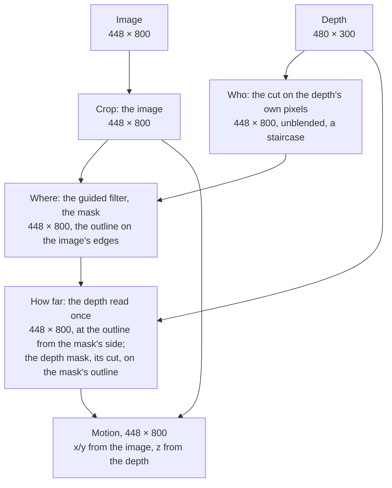

# The view

The flow's view of a capture, the stage before the motion: the camera image and the aligned depth cut to one
crop at the motion's size, the player's outline, and the depth read into it on that outline. What comes before it, the
uploader's corrected camera frame, is in [INPUT_THREADS.md](INPUT_THREADS.md#the-uploader); the sizes it works
at and why are in [RESOLUTION.md](RESOLUTION.md). **(deduction)** marks what is inferred.

The stage is `ViewLayer` (settings `view`, deep_flow's own, `apps/deep_flow/render/layers/view/view_layer.py`); its geometry and the
depth's read are plain modules in `modules/flow/view` (`view_window.py`, `depth_read.py`, `DepthCut`, `DepthUpscale`).

## The stage

The image has 800 rows and the depth 300, and only the image knows the player's outline sharply. So the depth
stays at its own size until the outline exists, and each step runs once per capture, in order: who, where, how
far. Each step but the crop is a part, a class with its textures, ports and settings group, and the monitor lists
each part's textures under its name:

| Step                       | Makes                                                                                  |
|----------------------------|----------------------------------------------------------------------------------------|
| the crop                   | the image cut to the view's crop (`crop`), at the view's `width` × `height`            |
| `depth_mask` (`ViewDepthMask`) | who: the cut, the player on the depth's own pixels, the depth pixel each view pixel lies in from `near` to `far`, unblended (`DepthCut`); where: the mask, the cut's outline moved onto the image's ([The mask and the depth mask](#the-mask-and-the-depth-mask)) |
| `depth` (`ViewDepth`)      | how far: the aligned depth read into the crop once, from the mask's side at the outline ([The depth read](#the-depth-read)), a `DepthView` ([MOTION.md](MOTION.md#when-it-measures)); and the depth mask, that depth cut to the band |
| `color_grade` (`ColorGrade`) | the graded image, the density's color: the image graded (`exposure`, `offset`, `gamma`, `contrast`, `saturation`) and sharpened (`sharpen`), premultiplied by the mask last (`use_mask`) |
| the pose                   | the pose's points placed in the crop, for the pose drawn over the view                 |

Its outputs, in the order it makes them, are the image, the depth, the depth mask, the mask and the graded
image, each the texture of the part that makes it; the input's depth is a depth in the band, drawn in its
colormap. The image and the graded image are both a color picture of the player at the view's size, as cut and
as graded; the bridge takes the graded image as its `color`, the density's. The color grade works on the straight
image and premultiplies it by the mask last, RGB and alpha alike, as compositing does and as the render blends
(Porter and Duff 1984; Brinkmann): grading or sharpening a cut
image changes its half-masked edge apart from the rest and pulls the cut's black into the edge. With
`color_grade.enabled` off the graded image is the image as it is, masked where `use_mask`.

The color is resampled twice, straightened in the uploader and cut to the view here, a little softer than one
resample **(deduction)**, for keeping the camera's work and the flow's apart.

| Setting                              | Preset        | Is                                                                        |
|--------------------------------------|---------------|---------------------------------------------------------------------------|
| `crop.center_x`, `center_y`, `height` | 0.5, 0.5, 1  | the crop's center and height on the camera image, shares of it            |
| `depth_mask.near`, `far`             | 0.1, 1.7 m    | the player's depth range, the box's front and back                        |
| `depth_mask.guided_radius`           | 2             | how far the image moves the mask's edge, in depth pixels; 0 off; also the read's reach for the mask's side |
| `depth_mask.edge_contrast`           | 0.03          | the image's brightness spread (0 to 1) above which the edge follows the image's |
| `depth.tolerance`                    | 0.2 m         | the depth jump beyond which the read blends no two depth pixels           |

## The depth read

The aligned depth is coarser than the view (`NEURAL_480`, 480 × 300 on the whole camera image), so each view
pixel reads it between its pixels (`DepthUpscale`, `depth_read.mask_sided_depth`), once, after the mask exists:

- Within a surface: the four depth pixels around a view pixel, interpolated bilinearly where they lie within
  `depth.tolerance` of each other, else the one it lies in, so an edge never reads as a distance in between; a 0,
  no depth, is never blended (`edge_aware_depth`).
- At the outline: where that depth is not on the pixel's side of the mask (a depth in `near`..`far` inside the
  mask, anything else, no depth included, outside it), the nearest depth pixel on its side within
  `guided_radius`, as that is how far the guided filter may move the mask's edge off the depth's; with none in
  reach it keeps its own.

The depth's edge and the depth mask's then lie on the mask's: no depth from behind the player lies inside the
mask, and z's gate cuts where the outline is. z is the depth's change over time per pixel, so a pixel that changes
side between two frames reads as z **(deduction)**. A depth pixel that straddles the outline is taken whole.

Two reads were compared before this one, kept here as the comparison it came from: `SURFACE`, the read within a
surface alone, the depth mask cut from it, a staircase of depth pixels; and `MASK`, that read, the cut and the
guided mask, then the read from the mask's side and the cut again, two reads and two cuts.

Not a read: joint bilateral upsampling with the camera image (Kopf, Cohen, Lischinski, Uyttendaele 2007, a 5 × 5
window, σd 0.5 depth pixel, σr 0.1 on color 0 to 1). It moves the mask with the depth, which costs x/y at the
edge, lowers z's signal with its noise, and carries the image's noise and texture into the depth (the table's
last row). No read adds depth detail inside the body: z takes x/y's resolution at the outline and stays the
depth's, interpolated, inside it. A depth pixel's own flicker stays, as a soft bump of its size; removing it
would filter the depth's noise.

Measured on the measure recording (`20261112-125832_measure`), `-sim`, its first 16 s from the in marker (still
1–5 s, the slow move 5.5–10 s, the fast 11.5–16 s), one run each, the motion's thresholds at 0, z in widths/s
at `z_gain` 0.4, every region from `SURFACE`'s mask: noise is the still part's p99 per pixel 6 px and more
inside the mask and within 6 px of its edge; slow and fast the mean inside; fit the image's brightness gradient
along the depth mask's edge, higher the closer it sits on the image's; "no z position" the share of the mask
where the motion's z position has no weight.

| Read                     | No z position | Fit    | z noise inside / edge | Slow  | Fast  | Fast ÷ noise | x/y at edge |
|--------------------------|---------------|--------|-----------------------|-------|-------|--------------|-------------|
| `SURFACE`                | 8.0%          | 0.0413 | 0.183 / 0.134         | 0.016 | 0.028 | 0.153        | 0.124       |
| `MASK`                   | 7.7%          | 0.0613 | 0.155 / 0.127         | 0.017 | 0.027 | 0.177        | 0.125       |
| joint bilateral, not kept | 10.1%         | 0.0590 | 0.138 / 0.115         | 0.015 | 0.024 | 0.177        | 0.159       |

A second `MASK` run gave noise 0.179 / 0.151: the noise differences lie within one run's swing. With `MASK`
the view's depth and the depth mask cover the whole mask, and its share without a z position lies where the
depth velocity's track has no depth: its step filter (`DepthStepFilter`,
[MOTION.md](MOTION.md#depth_velocity-z)) leaves a band a depth sample wide along every outline, whatever the
read. The bridge's outputs take their z positions from the trails, which fill it
([BRIDGE_3D.md](BRIDGE_3D.md#the-z-positions)).

The one path against those two, measured with `scripts/depth_velocity_capture.py` and
`depth_velocity_compare.py` on the measure recording: three captures of each path's first 16.5 s (the app at
about 19 fps while it saves the frames), replayed through the motion with its thresholds at 0, the still part 1–5
s, the slow move 5.5–10 s, the fast 11.5–16 s; z as the fluid gets it, in px per frame, gated by the mask and the
depth mask; noise the still part's p99 12 px and more inside the mask and within 6 px of its edge; slow and fast
z's mean inside; fit the image's brightness gradient (Sobel, 0 to 1) along the depth mask's edge; "no z position"
the share of the mask where the motion's z position has no weight. Each row the mean of three; one run's noise
swings by about ±0.07 inside.

| Path (`view.depth.tolerance` 0.2 m) | No z position | Fit   | z noise inside / edge | Slow  | Fast  | Fast ÷ noise | x/y at edge | View, GPU |
|-------------------------------------|---------------|-------|-----------------------|-------|-------|--------------|-------------|-----------|
| `SURFACE`, compared                 | 7.5%          | 0.325 | 0.398 / 1.054         | 0.102 | 0.123 | 0.32         | 1.79        |           |
| `MASK`, compared                    | 7.2%          | 0.493 | 0.425 / 1.106         | 0.108 | 0.117 | 0.28         | 1.83        |           |
| the one path                        | 7.2%          | 0.491 | 0.391 / 1.176         | 0.104 | 0.142 | 0.36         | 1.80        | 0.37 ms   |
| the one path, tolerance 0.1 m       | 7.3%          | 0.492 | 0.439 / 0.948         | 0.100 | 0.113 | 0.26         | 1.79        |           |
| the one path, tolerance 0.05 m      | 7.4%          | 0.493 | 0.425 / 1.068         | 0.103 | 0.116 | 0.28         | 1.79        |           |

The one path has `MASK`'s outline, its fit and its share without a z position, with one read and one cut fewer;
its noise lies within the runs' spread. Its fast z at 0.2 m is higher than every other row, by more than the
spread within a path; no mechanism in the code is found for it, so it is not counted as a gain.

The view's tolerance asks only whether two neighbouring depth pixels are one surface, to blend them; the motion's
own 0.2 m is that large for its job in time. At 0.1 and 0.05 m no column moves past the runs' spread (one run's
noise inside 0.38 to 0.49), so the preset keeps 0.2 m, never above the motion's.

Against reading the nearest depth pixel everywhere, on the stillslowfast recording, 3 runs, the motion's
thresholds at 0, `SURFACE` gives: neighbouring pixels inside the body with the very same depth 11% (67%), z
inside the mask p99 0.040 widths/s (0.057), z at the edge 0.041 (0.050), the mask's fit unchanged.

## The mask and the depth mask

The player's shape and where the depth is the player's are two things:

- `mask`: the cut, its edge moved onto the camera image's by the guided filter (He 2010), then the AA's
  threshold at 0.5, a crisp edge where the image puts it. Where the image has no edge the filter only averages
  the cut, and the threshold makes that a smoothed outline, the depth's own, within about a depth pixel.
  `guided_radius` is in the cut's (the depth's) pixels, how far its edge may be off, turned into the view's each
  frame from the crop; `edge_contrast` is squared inside as the filter's ε. It gates x/y in the motion with
  `use_mask`, and the dye's color in the bridge.
- `depth_mask`, the view's depth cut by `near` and `far`, is the motion's `depth_mask`: it gates z on top of
  the mask, always, and it is the z position's weight with the mask. The depth is read from the mask's side, so
  it lies on the mask's outline, where the depth has a player's depth in reach. The z position's value is held
  to 0..1 where the track lags past the range.

The dye's outline is the mask's: its color and the x/y and z of its amount stop at the guided edge.

The preset has no erosion, as one pulls the guided edge off the image's. Measured on stillslowfast, the still
part, the motion's thresholds at 0; z and x/y in widths/s, p99 within 6 px of the mask's edge and inside it;
fit along the mask's edge. One run's p99 swings by about ±0.02; fit holds to ±0.0003.

| Mask                                | Runs | z at edge (p99 / mean) | z inside | x/y at edge | Fit    |
|-------------------------------------|------|------------------------|----------|-------------|--------|
| the cut, erosion 1, z by the mask   | 3    | 0.053 / 0.0040         | 0.087    | 0.030       | 0.0308 |
| guided 2, erosion 0                 | 3    | 0.050 / 0.0036         | 0.057    | 0.028       | 0.0449 |
| guided 1.5, erosion 0               | 3    | 0.053 / 0.0036         | 0.064    | 0.028       | 0.0435 |
| guided 1.5, erosion 1               | 1    | 0.052 / 0.0041         | 0.063    | 0.025       | 0.0276 |
| guided 1.5, erosion 2               | 1    | 0.053 / 0.0041         | 0.066    | 0.030       | 0.0210 |
| guided 2, erosion 0, contrast 0.015 | 1    | 0.053 / 0.0037         | 0.106    | 0.027       | 0.0450 |
| guided 2, erosion 0, contrast 0.06  | 1    | 0.065 / 0.0041         | 0.078    | 0.027       | 0.0442 |

## Checked

`apps/deep_flow/scripts/view_check.py` plays a recording's captures through the uploader and the view stage and
holds the cut and the read to their numpy references:

| Pass                      | Pixels off the reference, 40 captures of the measure recording                                |
|---------------------------|-----------------------------------------------------------------------------------------------|
| the cut (`depth_cut`)     | none                                                                                          |
| the read (`mask_sided_depth`) | none by over 1 mm; 0.02% a tie between two depth pixels on the mask's side equally near, either the rule's |
| joint bilateral, not kept | none by over 2 cm, at most 1.2 cm: the GPU blends the image with coarser weights              |

The mask overlaps the depth mask exactly (with `SURFACE` it was 98%). Its passes on the GPU, the median of 40:
the crop 0.02 ms, the cut 0.02, the guide 0.17, the read and its cut 0.10, the color grade 0.05, the whole view
0.37. Without the app: `modules/flow/tests/test_view_window.py`, the window's geometry, the cut and the read.
