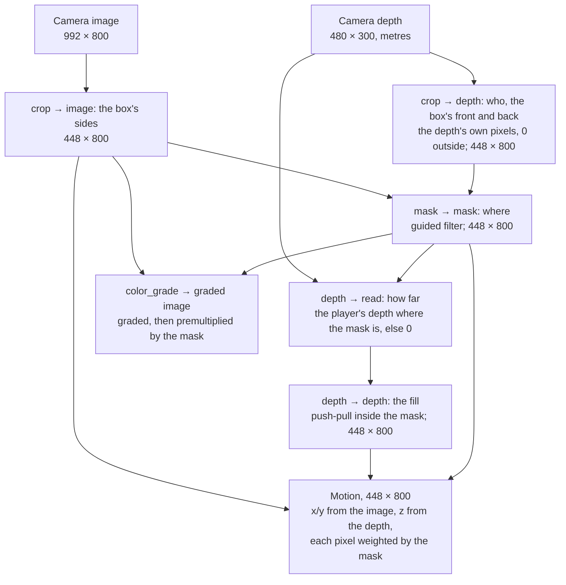

# The view

The flow's view of a capture, the stage before the motion: a box cropped in 3D from the camera image and the
aligned depth at the motion's size, the player's outline, and the player's depth wherever that outline is. What
comes before it, the uploader's corrected camera frame, is in [INPUT_THREADS.md](INPUT_THREADS.md#the-uploader);
the sizes it works at and why are in [RESOLUTION.md](RESOLUTION.md). **(deduction)** marks what is inferred.

The stage is `ViewLayer` (settings `view`, deep_flow's own, `apps/deep_flow/render/layers/view/view_layer.py`); its geometry and the
depth's read and fill are plain modules in `modules/flow/view` (`view_window.py`, `depth_read.py`, `DepthCrop`,
`DepthUpscale`, `DepthFill`).

## The goal

Who, where and how far, from one frame: the player's image, mask and depth, agreeing pixel for pixel at the
motion's size, adding no noise of its own. What needs two frames is the motion's. It is judged on the motion's
raw output ([FLOW.md](FLOW.md#the-goals)).

## The stage

The image has 800 rows and the depth 300, and only the image knows the player's outline sharply. So the depth
stays at its own size until the outline exists, and each step runs once per capture, in order: who, where, how
far. What one frame shows is the view's; what needs two frames is the motion's. Each step is a part, a class with
its textures, ports and settings group, and the monitor lists each part's textures under its name:

| Step                         | Makes                                                                                |
|------------------------------|--------------------------------------------------------------------------------------|
| `crop` (`ViewCrop`)          | the box in 3D: `image`, the camera image inside its sides (`center_x`, `center_y`, `height`) at the view's `width` × `height`; who: `depth`, the camera's depth inside its front and back (`near`, `far`) on the depth's own pixels, unblended, 0 outside (`DepthCrop`) |
| `mask` (`ViewMask`)          | where: `mask`, the crop's depth's outline moved onto the image's ([The mask](#the-mask)) |
| `depth` (`ViewDepth`)        | how far: `read`, the aligned depth read into the view once where it is the player's and the mask is; `depth`, that read filled across the mask ([The depth](#the-depth)), a `DepthView` ([MOTION.md](MOTION.md#when-it-measures)) |
| `color_grade` (`ColorGrade`) | the graded image, the density's color: the image graded (`exposure`, `offset`, `gamma`, `contrast`, `saturation`) and sharpened (`sharpen`), premultiplied by the mask last (`use_mask`) |
| the pose                     | the pose's points placed in the crop, for the pose drawn over the view               |

The mask and the depth agree pixel for pixel: the depth is the player's wherever the mask is above 0, as in the
matting model, where the foreground layer, its color and its depth, is defined wherever alpha is (Zitnick et al.
2004 store color, depth and alpha per layer). So the motion weights each pixel by the mask and needs no second
mask.

Its outputs, in the order it makes them, are the image, the mask, the depth and the graded image, each the
texture of the part that makes it; the input's depth is a depth in the box's range, drawn in its colormap. The image and the graded image are both a color picture of the player at the view's size, as cut and
as graded; the bridge takes the graded image as its `color`, the density's. The color grade works on the straight
image and premultiplies it by the mask last, RGB and alpha alike, as compositing does and as the render blends
(Porter and Duff 1984; Brinkmann): grading or sharpening a cut
image changes its half-masked edge apart from the rest and pulls the cut's black into the edge. With
`color_grade.enabled` off the graded image is the image as it is, masked where `use_mask`.

The color is resampled twice, straightened in the uploader and cut to the view here, a little softer than one
resample **(deduction)**, for keeping the camera's work and the flow's apart.

| Setting                              | Preset        | Is                                                                        |
|--------------------------------------|---------------|---------------------------------------------------------------------------|
| `crop.center_x`, `center_y`, `height` | 0.5, 0.5, 1  | the box's sides: its center and height on the camera image, shares of it  |
| `crop.near`, `far`                   | 0.1, 1.7 m    | the box's front and back, the player's depth range                        |
| `mask.guided_radius`                 | 2             | how far the image moves the mask's edge, in depth pixels; 0 off           |
| `mask.edge_contrast`                 | 0.03          | the image's brightness spread (0 to 1) above which the edge follows the image's |

## The depth

The aligned depth is coarser than the view (`NEURAL_480`, 480 × 300 on the whole camera image), and its edge is
coarser than the mask's: between them lies a band about `guided_radius` wide (2 depth pixels, about 5 view
pixels) where the mask is and the player's depth is not. The depth is made in two passes, once, after the mask
exists:

- The read (`DepthUpscale`, `depth_read.masked_depth`): the four depth pixels around a view pixel, interpolated
  bilinearly where they lie within 0.1 m of each other (`EDGE`, `view_depth.py`), else the one it lies in, so an
  edge never reads as a distance in between; a 0, no depth, is never blended (`edge_aware_depth`). Kept where it
  is the player's (`near`..`far`) and the mask is above 0, else 0. The edge's jump is a constant, not a setting:
  it lies above the depth's noise between neighbours on one surface and below the smallest edge to keep, a hand
  before the chest, as the motion's `z.edge` (0.1 m); 0.05, 0.1 and 0.2 m measured alike, no limit did not (the
  tables below). It keeps the edges inside the mask (an arm before the body) from reading as a depth in between,
  and so more of the mask keeps a z position through the motion.
- The fill (`DepthFill`, `depth_read.push_pull`): push-pull (Gortler et al. 1996). Push: each level down halves
  the size, rounded up, to 1 × 1, a pixel the mean of the pairs (depth × weight, weight) below it, the read's
  weight 1 where it has a depth. Pull: from the coarsest up, a level's pair plus (1 − its weight) times the
  coarser pulled level's, read bilinearly. A pixel with a depth keeps it; one without takes the mean of the depth
  around it, from the finest level that has one. Where the mask is 0 the depth is 0. The band between the
  depth's edge and the mask's takes the depth just inside it, and the camera's few holes in the body are filled on
  the way. A filled pixel moves with its surroundings, rather than reading as no z. The fill is always on: it
  gives every pixel of the mask a depth, so the density made there has a place in the fluid, and it leaves the
  motion's z as it was (the table below, with and without it).

The fill takes the mean around a pixel, not the nearest pixel or a plane: a plane fitted at the outline extends
the edge's slope, where the stereo is noisiest **(deduction)**. z is the depth's change over time per pixel, so a
pixel that changes side between two frames reads as z **(deduction)**; that is the motion's to weigh. A depth
pixel that straddles the outline is taken whole.

Two reads were compared before this one, kept here as the comparison it came from: `SURFACE`, the read within a
surface alone, the depth mask cut from it, a staircase of depth pixels; and `MASK`, that read, the cut and the
guided mask, then the read from the mask's side and the cut again, two reads and two cuts.

Not a read: joint bilateral upsampling with the camera image (Kopf, Cohen, Lischinski, Uyttendaele 2007, a 5 × 5
window, σd 0.5 depth pixel, σr 0.1 on color 0 to 1). It moves the mask with the depth, which costs x/y at the
edge, lowers z's signal with its noise, and carries the image's noise and texture into the depth (the table's
last row). No read adds depth detail inside the body: z takes x/y's resolution at the outline and stays the
depth's, interpolated, inside it. A depth pixel's own flicker stays, as a soft bump of its size; removing it
would filter the depth's noise.

Measured on the measure recording (`20261112-125832_measure`), `-sim`, its first 16 s from the in marker (still
1–5 s, the slow move 5.5–10 s, the fast 11.5–16 s), one run each, the motion's thresholds at 0, z in widths/s
at `z_gain` 0.4, every region from `SURFACE`'s mask: noise is the still part's p99 per pixel 6 px and more
inside the mask and within 6 px of its edge; slow and fast the mean inside; fit the image's brightness gradient
along the depth mask's edge, higher the closer it sits on the image's; "no z position" the share of the mask
where the motion's z position has no weight.

| Read                     | No z position | Fit    | z noise inside / edge | Slow  | Fast  | Fast ÷ noise | x/y at edge |
|--------------------------|---------------|--------|-----------------------|-------|-------|--------------|-------------|
| `SURFACE`                | 8.0%          | 0.0413 | 0.183 / 0.134         | 0.016 | 0.028 | 0.153        | 0.124       |
| `MASK`                   | 7.7%          | 0.0613 | 0.155 / 0.127         | 0.017 | 0.027 | 0.177        | 0.125       |
| joint bilateral, not kept | 10.1%         | 0.0590 | 0.138 / 0.115         | 0.015 | 0.024 | 0.177        | 0.159       |

A second `MASK` run gave noise 0.179 / 0.151: the noise differences lie within one run's swing. With `MASK`
the view's depth and the depth mask cover the whole mask, and its share without a z position lies where the
depth velocity's track has no depth: its step filter (`DepthStepFilter`,
[MOTION.md](MOTION.md#depth_velocity-z)) leaves a band a depth sample wide along every outline, whatever the
read. The bridge's outputs take their z positions from the trails, which fill it
([BRIDGE_3D.md](BRIDGE_3D.md#the-z-positions)).

The one path against those two, measured with `scripts/depth_velocity_capture.py` and
`depth_velocity_compare.py` on the measure recording: three captures of each path's first 16.5 s (the app at
about 19 fps while it saves the frames), replayed through the motion with its thresholds at 0 and z smoothed as
the preset then had it (`z.smooth` 100 ms, `z.catch_up` 8 ms), the still part 1–5 s, the slow move 5.5–10 s, the
fast 11.5–16 s; z as the fluid gets it, in px per frame, gated by the mask and the depth mask; noise the still
part's p99 12 px and more inside the mask and within 6 px of its edge; slow and fast z's mean inside; fit the
image's brightness gradient (Sobel, 0 to 1) along the depth mask's edge; "no z position" the share of the mask
where the motion's z position has no weight. Each row the mean of three; one run's noise swings by about ±0.07
inside.

| Path (`view.depth.tolerance` 0.2 m) | No z position | Fit   | z noise inside / edge | Slow  | Fast  | Fast ÷ noise | x/y at edge | View, GPU |
|-------------------------------------|---------------|-------|-----------------------|-------|-------|--------------|-------------|-----------|
| `SURFACE`, compared                 | 7.5%          | 0.325 | 0.398 / 1.054         | 0.102 | 0.123 | 0.32         | 1.79        |           |
| `MASK`, compared                    | 7.2%          | 0.493 | 0.425 / 1.106         | 0.108 | 0.117 | 0.28         | 1.83        |           |
| the one path                        | 7.2%          | 0.491 | 0.391 / 1.176         | 0.104 | 0.142 | 0.36         | 1.80        | 0.37 ms   |
| the one path, tolerance 0.1 m       | 7.3%          | 0.492 | 0.439 / 0.948         | 0.100 | 0.113 | 0.26         | 1.79        |           |
| the one path, tolerance 0.05 m      | 7.4%          | 0.493 | 0.425 / 1.068         | 0.103 | 0.116 | 0.28         | 1.79        |           |

The one path has `MASK`'s outline, its fit and its share without a z position, with one read and one cut fewer;
its noise lies within the runs' spread. Its fast z at 0.2 m is higher than every other row, by more than the
spread within a path; no mechanism in the code is found for it, so it is not counted as a gain.

The view's tolerance asks only whether two neighbouring depth pixels are one surface, to blend them; the motion's
own 0.2 m is that large for its job in time. At 0.1 and 0.05 m no column moves past the runs' spread (one run's
noise inside 0.38 to 0.49), so the preset keeps 0.2 m, never above the motion's.

The view as built (the read where the mask is, then the fill) against the one path before it, on the motion's raw
output: the same recording and segments, three captures each, replayed with the thresholds, `z.smooth` and
`z.catch_up` at 0; the earlier paths' own three captures replayed the same way, their depth set to 0 where their
depth mask was 0, which gives z what the depth mask's gate gave it (no z and no z position there, x/y as it was);
z weighted by the mask; regions from the mask above 0.5; fit along the mask's edge. The earlier captures hold the
mask as 0 or 1, the view's as 0 to 1, which touches about one pixel of the edge's six. One run's noise swings by
about ±0.4 inside and ±0.3 at the edge.

| View (`view.depth.tolerance` 0.2 m)   | No z position | Fit   | z noise inside / edge | Slow  | Fast  | Fast ÷ noise | x/y at edge | View, GPU |
|---------------------------------------|---------------|-------|-----------------------|-------|-------|--------------|-------------|-----------|
| `MASK`, gated by its depth mask       | 3.7%          | 0.493 | 12.32 / 5.93          | 0.567 | 0.828 | 0.067        | 1.87        |           |
| the one path, gated by its depth mask | 3.7%          | 0.491 | 12.28 / 5.90          | 0.540 | 0.855 | 0.070        | 1.84        |           |
| the read alone, without the fill      | 4.4%          | 0.491 | 11.97 / 5.94          | 0.559 | 0.843 | 0.071        | 1.75        |           |
| the read and the fill, the preset     | 3.9%          | 0.492 | 11.84 / 6.07          | 0.542 | 0.831 | 0.070        | 1.82        | 0.20 ms   |
| the same, tolerance 10 m (bilinear)   | 6.0%          | 0.492 | 12.37 / 5.15          | 0.560 | 0.821 | 0.067        | 1.82        |           |

The view as built gives z what the paths before it gave, with no depth mask: every column lies within the runs'
spread but the share without a z position, 3.9% against 3.7%, with no mechanism found. Without the fill the band
between the depth's edge and the mask's has no z (4.4%). What is left with the fill is the motion's step filter's
band ([MOTION.md](MOTION.md#depth_velocity-z)). The earlier paths replayed without their gate gave an edge noise of
15.2, z from the background's depth the read left inside the mask.

Without the tolerance's limit (10 m, the four depth pixels always blended) the share without a z position rises
from 3.9% to 6.0% and the edge's noise falls from 6.1 to 5.2, both past the runs' spread: a blend across an edge
makes a ramp of in-between depths, whose steps the motion's step filter drops, so fewer pixels at the edge carry
z **(deduction)**. With the limit, more of the mask carries z and the edge is a little noisier; the real z,
slow and fast, is the same either way.

Against reading the nearest depth pixel everywhere, on the stillslowfast recording, 3 runs, the motion's
thresholds at 0, `SURFACE` gives: neighbouring pixels inside the body with the very same depth 11% (67%), z
inside the mask p99 0.040 widths/s (0.057), z at the edge 0.041 (0.050), the mask's fit unchanged.

## The mask

The mask is where the crop's depth is (above 0), its edge moved onto the camera image's by the guided filter (He
2010; its first pass takes the depth's presence, `GuidedFilter.products(presence=True)`), then thresholded at 0.5
and antialiased over one pixel (`MaskAntialias`): a crisp edge where the image puts it, soft over one pixel. Where
the image has no edge the filter only averages the presence, and the threshold makes that a smoothed outline, the
depth's own, within about a depth pixel. `guided_radius` is in the depth's pixels, how far its edge may be off,
turned into the view's each frame from the crop; at 0 the filter gives the presence itself. `edge_contrast` is
squared inside as the filter's ε. The mask weights x/y and z in the motion with `use_mask`, is the z position's
weight, and gates the dye's color in the bridge.

The dye's outline is the mask's: its color and the x/y and z of its amount stop at the guided edge.

The preset has no erosion, as one pulls the guided edge off the image's. Measured on stillslowfast, the still
part, the motion's thresholds at 0; z and x/y in widths/s, p99 within 6 px of the mask's edge and inside it;
fit along the mask's edge. One run's p99 swings by about ±0.02; fit holds to ±0.0003.

| Mask                                | Runs | z at edge (p99 / mean) | z inside | x/y at edge | Fit    |
|-------------------------------------|------|------------------------|----------|-------------|--------|
| the cut, erosion 1, z by the mask   | 3    | 0.053 / 0.0040         | 0.087    | 0.030       | 0.0308 |
| guided 2, erosion 0                 | 3    | 0.050 / 0.0036         | 0.057    | 0.028       | 0.0449 |
| guided 1.5, erosion 0               | 3    | 0.053 / 0.0036         | 0.064    | 0.028       | 0.0435 |
| guided 1.5, erosion 1               | 1    | 0.052 / 0.0041         | 0.063    | 0.025       | 0.0276 |
| guided 1.5, erosion 2               | 1    | 0.053 / 0.0041         | 0.066    | 0.030       | 0.0210 |
| guided 2, erosion 0, contrast 0.015 | 1    | 0.053 / 0.0037         | 0.106    | 0.027       | 0.0450 |
| guided 2, erosion 0, contrast 0.06  | 1    | 0.065 / 0.0041         | 0.078    | 0.027       | 0.0442 |

## Checked

`apps/deep_flow/scripts/view_check.py` plays a recording's captures through the uploader and the view stage and
holds the crop's depth, the read and the fill to their numpy references:

| Pass                          | Pixels off the reference, 40 captures of the measure recording                            |
|-------------------------------|-------------------------------------------------------------------------------------------|
| the crop's depth (`depth_crop`) | none by over 1 mm                                                                       |
| the read (`masked_depth`)     | none by over 1 mm                                                                         |
| the fill (`push_pull`)        | none by over 1 mm                                                                         |
| joint bilateral, not kept     | none by over 2 cm, at most 1.2 cm: the GPU blends the image with coarser weights          |

The mask without depth is 1.62% of the mask in the read, 0.00% after the fill. The passes on the GPU, the median
of 40, are in [TIMING.md](TIMING.md#the-view). Without the app: `modules/flow/tests/test_view_window.py`, the
window's geometry, the crop's depth, the read and the fill.
