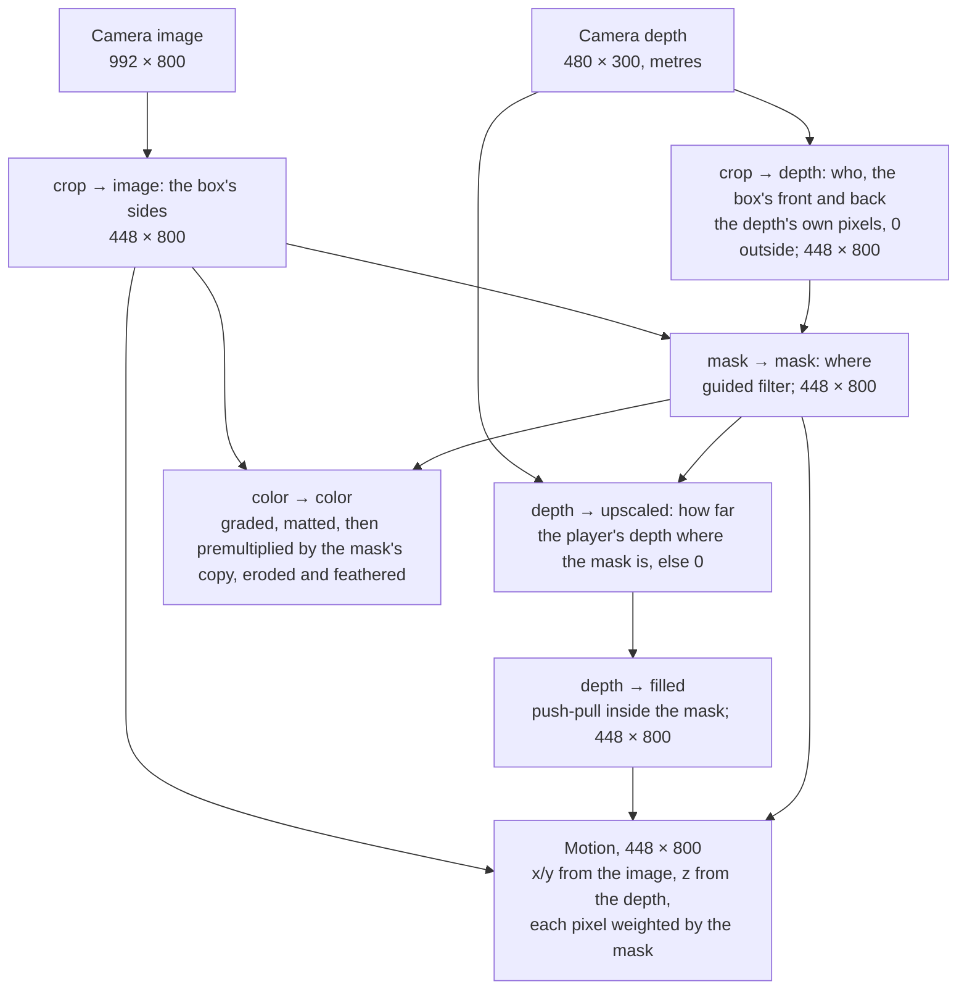

# The view

The flow's view of a capture, the stage before the motion: a box cropped in 3D from the camera image and the
aligned depth at the motion's size, the player's outline, and the player's depth wherever that outline is. What
comes before it, the uploader's corrected camera frame, is in [INPUT_THREADS.md](INPUT_THREADS.md#the-uploader);
the sizes it works at and why are in [RESOLUTION.md](RESOLUTION.md). **(deduction)** marks what is inferred.

The stage is `ViewLayer` (settings `view`, deep_flow's own, `apps/deep_flow/render/layers/view/view_layer.py`); its geometry and the
depth's upscale and fill are plain modules in `modules/flow/view` (`view_window.py`, `DepthCrop`, `DepthUpscale`,
`DepthFill`).

## The goal

Who, where and how far, from one frame: the player's image, mask and depth, agreeing pixel for pixel at the
motion's size, adding no noise of its own. What needs two frames is the motion's. It is judged on the motion's
raw output ([FLOW.md](FLOW.md#the-goals)).

## The stage

The image has 800 rows and the depth 300, and only the image knows the player's outline sharply. So the depth
stays at its own size until the outline exists, and each step runs once per capture, in order: who, where, how
far. What one frame shows is the view's; what needs two frames is the motion's. Each step is a part, a class with
its textures, ports and settings group, and the monitor lists each part's textures under its name:

| Step                         | Makes                                                                                |
|------------------------------|--------------------------------------------------------------------------------------|
| `crop` (`ViewCrop`)          | the box in 3D: `image`, the camera image inside its sides (`center_x`, `center_y`, `height`) at the view's `width` × `height`; who: `depth`, the camera's depth inside its front and back (`near`, `far`) on the depth's own pixels, unblended, 0 outside (`DepthCrop`) |
| `mask` (`ViewMask`)          | where: `mask`, the crop's depth's outline moved onto the image's ([The mask](#the-mask)) |
| `depth` (`ViewDepth`)        | how far: `upscaled`, the aligned depth upscaled to the view once where it is the player's and the mask is; `filled`, that filled across the mask, the view's depth ([The depth](#the-depth)), a `DepthView` ([MOTION.md](MOTION.md#when-it-measures)) |
| `color` (`ViewColor`)        | `color`, the player's color for the density: the image graded (`exposure`, `offset`, `gamma`, `contrast`, `saturation`) and sharpened (`sharpen`), its alpha a matte from its brightness (`luma_matte`), premultiplied last by the mask's copy (`use_mask`), its edge eroded by `erode` and feathered inward over `feather` view pixels |
| the pose                     | the pose's points placed in the crop, for the pose drawn over the view               |

The mask and the depth agree pixel for pixel: the depth is the player's wherever the mask is above 0, as in the
matting model, where the foreground layer, its color and its depth, is defined wherever alpha is (Zitnick et al.
2004 store color, depth and alpha per layer). So the motion weights each pixel by the mask and needs no second
mask.

Its outputs, in the order it makes them, are the image, the mask, the depth and the color, each the texture of
the part that makes it; the input's depth is a depth in the box's range, drawn in its colormap. The image and the
color are both a color picture of the player at the view's size, as cut and as graded; the bridge takes the color
as its `image`, the density's color, its alpha kept as the color's coverage ([BRIDGE_3D.md](BRIDGE_3D.md#the-mix)).
The color part works on the straight image and premultiplies it by the mask last, RGB and alpha alike, as
compositing does and as the render blends (Porter and Duff 1984; Brinkmann): grading or sharpening a cut image
changes its half-masked edge apart from the rest and pulls the cut's black into the edge. With `color.enabled` off
the color is the image as it is, matted and masked as set.

The luma matte, after the grading and the sharpening and before the premultiply, is a matte from the color's
brightness, its brightest channel (HSV's value), as video compositing mattes a picture by its brightness: darkness
becomes transparency. The alpha becomes 1 − `luma_matte` + `luma_matte` × that brightness, the RGB as it is
(`shaders.LumaMatte`). The premultiply then multiplies both by the mask's copy, so the stored alpha is the feather
times the matte. At 1, the default, a half-dark red is full red at half the
alpha and black brings in nothing, so dark clothes and shadows leave no dark patches in the fluid **(site
fact)**; at 0 the alpha is the feather's alone. With `use_mask` off the color has no edge.

The premultiply takes a copy of the mask, worked as compositing works a matte where the picture is made, so the
mask the motion and the depth use stays as it is:
- `erode` moves the copy's edge inward by whole pixels, one 3 × 3 minimum each (`Erode`), dropping the outermost
  pixels, whose color the camera mixed with the background's;
- `feather` then fades it in inward over its width: the copy blurred by a Gaussian of half the width is 0.5 on
  its edge, and 2 × it − 1, clamped (`Feather`), is 0 on and outside the edge and rises to 1 inside, so nothing
  reaches past the eroded edge.

The color is resampled twice, straightened in the uploader and cut to the view here, a little softer than one
resample **(deduction)**, for keeping the camera's work and the flow's apart.

| Setting                              | Preset        | Is                                                                        |
|--------------------------------------|---------------|---------------------------------------------------------------------------|
| `crop.center_x`, `center_y`, `height` | 0.5, 0.5, 1  | the box's sides: its center and height on the camera image, shares of it  |
| `crop.near`, `far`                   | 0.1, 1.7 m    | the box's front and back, the player's depth range                        |
| `mask.guided_radius`                 | 2             | how far the image moves the mask's edge, in depth pixels; 0 off           |
| `mask.edge_contrast`                 | 0.03          | the image's brightness spread (0 to 1) above which the edge follows the image's |

## The depth

The aligned depth is coarser than the view (`NEURAL_480`, 480 × 300 on the whole camera image), and its edge is
coarser than the mask's: between them lies a band about `guided_radius` wide (2 depth pixels, about 5 view
pixels) where the mask is and the player's depth is not. The depth is made in two passes, once, after the mask
exists:

- The upscale (`DepthUpscale`): the four depth pixels around a view pixel, interpolated bilinearly where they lie
  within 0.1 m of each other (`EDGE`, `view_depth.py`), else the one it lies in, so an edge never reads as a
  distance in between; a 0, no depth, is never blended. Kept where it
  is the player's (`near`..`far`) and the mask is above 0, else 0. The edge's jump is a constant, not a setting:
  it lies above the depth's noise between neighbours on one surface and below the smallest edge to keep, a hand
  before the chest, as the motion's `z.edge` (0.1 m); 0.05, 0.1 and 0.2 m measured alike on the views before this one, no limit did not (the
  table below). It keeps the edges inside the mask (an arm before the body) from reading as a depth in between,
  and so more of the mask keeps a z position through the motion.
- The fill (`DepthFill`): push-pull (Gortler et al. 1996). Push: each level down halves
  the size, rounded up, to 1 × 1, a pixel the mean of the pairs (depth × weight, weight) below it, the upscaled
  depth's weight 1 where it has a depth. Pull: from the coarsest up, a level's pair plus (1 − its weight) times the
  coarser pulled level's, read bilinearly. A pixel with a depth keeps it; one without takes the mean of the depth
  around it, from the finest level that has one. Where the mask is 0 the depth is 0. The band between the
  depth's edge and the mask's takes the depth just inside it, and the camera's few holes in the body are filled on
  the way. A filled pixel moves with its surroundings, rather than reading as no z. The fill is always on: it
  gives every pixel of the mask a depth, so the density made there has a place in the fluid, and it leaves the
  motion's z as it was (the table below, with and without it).

The fill takes the mean around a pixel, not the nearest pixel or a plane: a plane fitted at the outline extends
the edge's slope, where the stereo is noisiest **(deduction)**. z is the depth's change over time per pixel, so a
pixel that changes side between two frames reads as z **(deduction)**; that is the motion's to weigh. A depth
pixel that straddles the outline is taken whole.

Not a read: joint bilateral upsampling with the camera image (Kopf, Cohen, Lischinski, Uyttendaele 2007). It
moves the mask with the depth, which costs x/y at the edge, lowers z's signal with its noise, and carries the
image's noise and texture into the depth. No read adds depth detail inside the body: z takes x/y's resolution at
the outline and stays the depth's, interpolated, inside it. A depth pixel's own flicker stays, as a soft bump of
its size; removing it would filter the depth's noise.

The upscale's edge, 0.1 m (`EDGE`), keeps the four depth pixels of one surface: blended across an edge, they
make a ramp of in-between depths whose steps the motion's step filter drops, so fewer pixels at the edge carry z
(on the earlier path at 20 frames a second, the share of the mask without a z position 3.9% with the limit, 6.0%
without it) **(deduction)**.

Measured with `scripts/depth_velocity_capture.py` and `depth_velocity_compare.py` on the measure recording
(`20261112-125832_measure`), 2026-11-16, commit fdf8f8de: three captures of its first 16.5 s, every camera frame
(810 a capture, `measure_1` to `measure_3`), replayed through the motion on its raw output (`xy.threshold`,
`z.threshold` and `z.smooth` at 0); the preset then (the view's `guided_radius` 3; the motion's `levels` 4, `edge`
0.1 m, `tolerance` 0.2 m, `dead_zone` 0.02 m); the still part 1–5 s, the slow move 5.5–10 s, the fast 11.5–16 s;
z as the fluid gets it, in px per frame, weighted by the mask; noise the still part's p99 12 px and more inside
the mask and within 6 px of its edge; slow and fast z's mean inside; fit the image's brightness gradient (Sobel,
0 to 1) along the mask's edge; "no z position" the share of the mask where the motion's z position has no weight;
regions from the mask above 0.5. In brackets the three captures' spread:

| Result                 | No z position | Fit   | z noise inside / edge | Slow  | Fast  | Fast ÷ noise | x/y at edge | View, GPU |
|------------------------|---------------|-------|-----------------------|-------|-------|--------------|-------------|-----------|
| the view as built      | 3.6% (0.0)    | 0.567 | 9.06 / 5.04 (0.03)    | 0.347 | 0.649 | 0.072        | 1.39 (0.00) | 0.20 ms   |

What is left without a z position is the motion's step filter's band ([MOTION.md](MOTION.md#depth_velocity-z)).

## The mask

The mask is where the crop's depth is (above 0), its edge moved onto the camera image's by the guided filter (He
2010; its first pass takes the depth's presence, `GuidedFilter.products(presence=True)`), then thresholded at 0.5
and antialiased over one pixel (`MaskAntialias`): a crisp edge where the image puts it, soft over one pixel. Where
the image has no edge the filter only averages the presence, and the threshold makes that a smoothed outline, the
depth's own, within about a depth pixel. `guided_radius` is in the depth's pixels, how far its edge may be off,
turned into the view's each frame from the crop; at 0 the filter gives the presence itself. `edge_contrast` is
squared inside as the filter's ε. The mask weights x/y and z in the motion with `use_mask`, is the z position's
weight, and gates the dye's color in the bridge.

The dye's outline is the mask's: its color and the x/y and z of its amount stop at the guided edge.

The mask has no erosion, as one pulls the guided edge off the image's; the color's own copy of it can be eroded
([The stage](#the-stage)).

## Checked

Shaders are checked in a GPU harness. `apps/deep_flow/scripts/view_check.py` plays a recording's captures through
the uploader and the view stage, prints the share of the mask without depth, times each pass (`--time`) and saves
the last capture's textures side by side (`--png`).

The mask without depth is 1.62% of the mask upscaled, 0.00% after the fill. The passes on the GPU, the median
of 40, are in [TIMING.md](TIMING.md#the-view). Without the app: `modules/flow/tests/test_view_window.py`, the
window's geometry and the fill's pyramid sizes.
